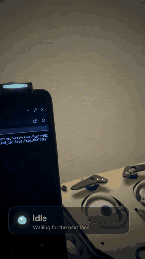
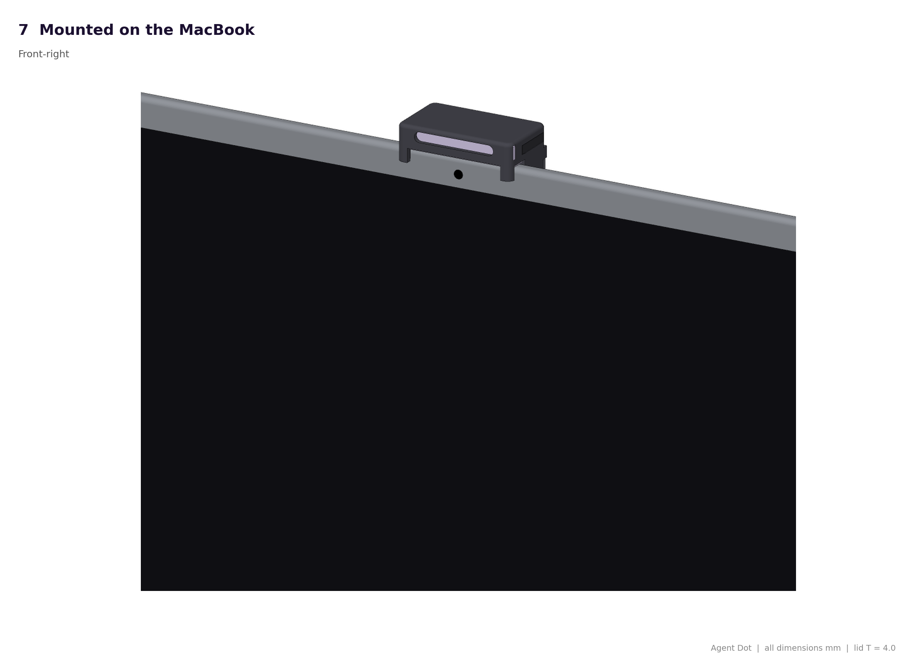
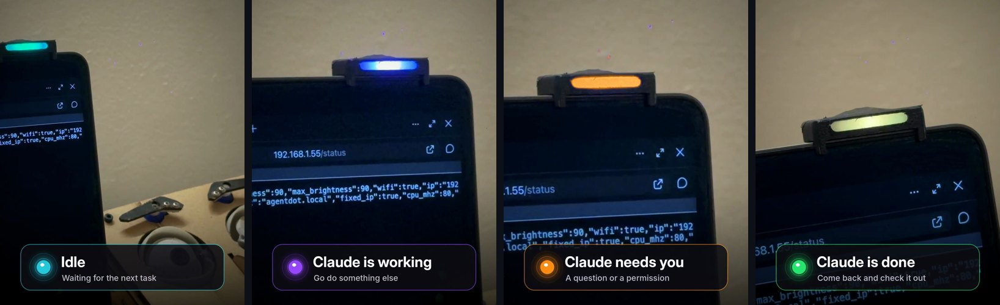
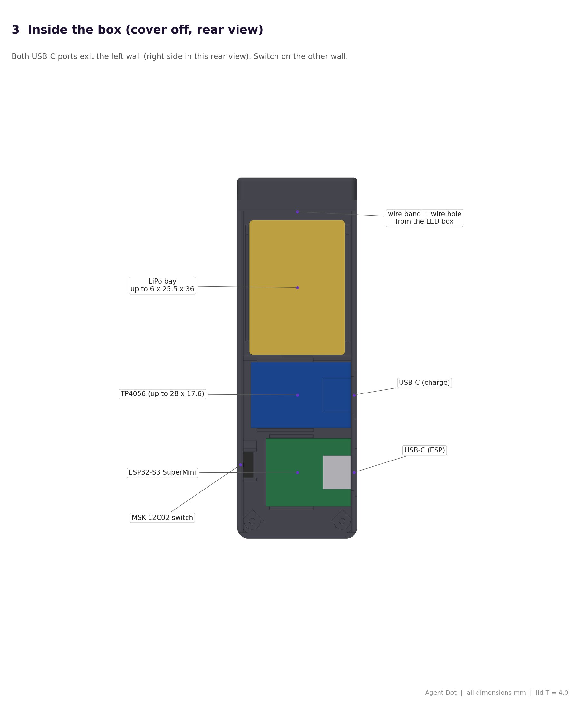
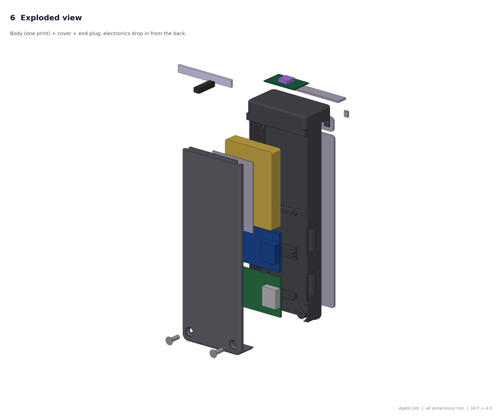
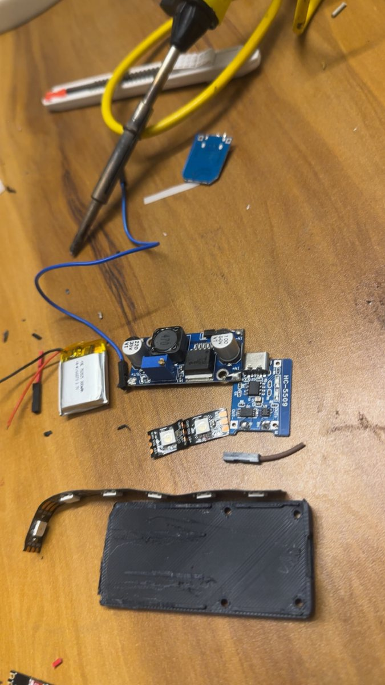
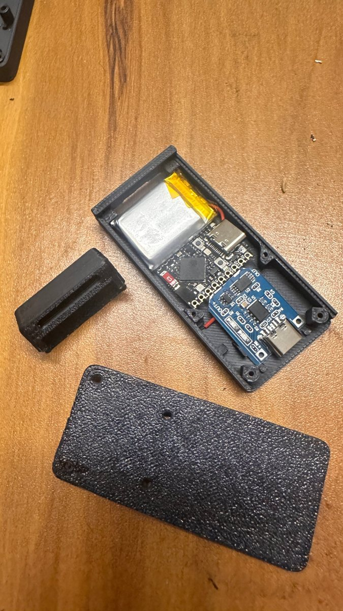

# Agent Dot

**A tiny RGB status light that clips to the top of your laptop screen and shows what your AI agent is doing.**

<p align="center">
  <a href="media/AgentDot_promo_v4.mp4"></a>
  &nbsp;&nbsp;
  
</p>

<p align="center"><b><a href="media/AgentDot_promo_v4.mp4">▶ Watch the full demo (84 s)</a></b></p>

| Light | Meaning |
|---|---|
| 🟣 purple sweep | the agent is thinking / working |
| 🟠 amber pulse | the agent needs you (a question or a permission prompt) |
| 🟢 green | the agent finished (fades back to idle after a minute) |
| 🔴 red | something went wrong |
| 🩵 dim teal breathe | idle (goes fully dark after 10 quiet minutes to save battery) |



The light sits on the screen's top edge, so you can look away and still see when Claude needs you or is done. It works with **Claude Code** (hooks, over your Wi-Fi) and with the **Claude desktop app** (a small Mac watcher that sees when Claude is answering). If several sessions run at once, it shows the most important state across all of them: needs-you, then error, then working, then done.

Built for low latency and silent failure: hooks return in a few milliseconds and send in the background, so an offline or sleeping light never slows Claude down or shows an error.

Everything here is open source: the parametric CAD (FreeCAD), ready-to-print files for a Bambu Lab A1, the ESP32 firmware, the Claude integrations, and the docs.

## What's in this repository

```
firmware/               ESP32 firmware (Arduino IDE or PlatformIO) - XIAO ESP32C3, C3/S3 SuperMini
hooks/                  Claude Code hooks + installer (local network, no cloud)
mac/                    AgentDotWatch: follows the Claude desktop app via Accessibility (+ launchd setup)
integrations/
  claude-app/agent-dot/ optional: Claude app plugin through an ntfy.sh relay (for remote / non-Mac use)
hardware/
  cad/                  parametric FreeCAD macro + validate / export / 3MF / render scripts (v12)
  print/3mf/            ready-to-print Bambu Lab A1 plates (4.0 mm lid)
  print/stl/            print-oriented STL meshes
  step/                 STEP models (parts + full assembly)
  drawings/             dimensioned drawings (PDF) and views (PNG)
  validation/           fit / interference / printability report (all checks pass)
media/                  promo video
docs/                   build guide, wiring, firmware, integrations, API, troubleshooting
```

## Quick start

**New here? Follow [docs/INSTALL.md](docs/INSTALL.md)** – the complete software setup in order (flash → Wi-Fi → fixed IP → test → Claude Code → Claude app), with the expected output of every step and fixes for the usual problems.

Building the hardware? **[docs/BUILD_GUIDE.md](docs/BUILD_GUIDE.md)** goes from parts to a working light.

1. **Get the parts** – [docs/BOM.md](docs/BOM.md). About US$10–15 of electronics.
2. **Print** – two PETG parts plus TPU pads, no supports – [docs/PRINTING.md](docs/PRINTING.md).
3. **Wire it** – [docs/WIRING.md](docs/WIRING.md) ([diagram](docs/images/wiring_diagram.png)).
4. **Flash the firmware** and join it to your Wi-Fi – [docs/FIRMWARE.md](docs/FIRMWARE.md).
5. **Connect Claude**
   - Claude Code: `bash hooks/install.sh <light-ip>` – [docs/CLAUDE_CODE.md](docs/CLAUDE_CODE.md).
   - Claude desktop app on a Mac: `bash mac/install.sh <light-ip>`, then allow Accessibility – [docs/CLAUDE_APP.md](docs/CLAUDE_APP.md).
   - Anything else: it's a tiny HTTP API – [docs/API.md](docs/API.md).

Stuck? [docs/TROUBLESHOOTING.md](docs/TROUBLESHOOTING.md) covers every problem hit while building the first one.

## Test it end to end

Replace `192.168.1.42` with your light's IP (the Serial Monitor prints it, or use `agentdot.local`).

```bash
IP=192.168.1.42
curl "http://$IP/s?c=working"     # purple sweep
curl "http://$IP/s?c=input"       # amber pulse   (same as c=waiting)
curl "http://$IP/s?c=done"        # green, back to idle after a minute
curl "http://$IP/s?c=error"       # red
curl "http://$IP/s?c=idle"        # dim teal
curl "http://$IP/s?c=off"         # LEDs off
curl "http://$IP/status"          # JSON: state, ip, rssi, ...

# latency: should print well under 0.1 s on a good network
curl -o /dev/null -s -w '%{time_total}s\n' "http://$IP/s?c=working"

# hooks: the same script Claude Code runs - must return instantly, even with the light switched off
time ~/.agentdot/agentdot.sh working </dev/null
```

Then send a prompt in Claude Code (purple → amber on a permission prompt → green), and do the same in the Claude desktop app with the watcher running (purple while it answers → amber when it asks you something → green).

## Hardware (v12)

| Inside (cover off) | Exploded |
|---|---|
|  |  |

| On the bench | Built |
|---|---|
|  |  |

- **Two main prints:** a one-piece **body** (6 mm LED box + lid clamp + controller box) and a **cover** (2 × M2×6 screws). A tiny end plug closes the LED slot; thin TPU pads line the clamp.
- **One RGB pixel** at the back of the LED box, behind a front diffuser.
- **ESP32 SuperMini + TP4056 USB-C charger**, each in its own slot, both USB-C ports reachable from the side: one to charge, one to flash.
- **32 W × 96.3 H × 18.1 D mm**, 6.8 mm above the lid edge, 11 mm behind it. Prints with no supports.

Details, files and assembly: [hardware/README.md](hardware/README.md). The printed parts carry no logo or text.

## How it works

```
Claude Code ──hooks──► ~/.agentdot/agentdot.sh ──background curl (≤1.5 s)──► http://<light-ip>/s?c=working ─┐
                                                                                                          ├─► ESP32 ─► WS2812B
Claude desktop app ◄─Accessibility─ AgentDotWatch (200 ms poll, sends on change) ─► /s?c=working|waiting|done ┘
```

The firmware keeps one entry per session, shows the highest-priority one, fades "done" to idle after a minute and drops sessions that go silent for 30 minutes, so the light never gets stuck. Every request carries a timestamp, so one that arrives late can't overwrite a newer state.

**Power:** 80 MHz CPU, Wi-Fi modem sleep, LEDs are only refreshed when a pixel changes, and after 10 quiet minutes the idle glow goes dark and the radio drops to deeper modem sleep (the next request still gets through, about 0.1–0.3 s slower). Optional deep sleep for long breaks – see [docs/FIRMWARE.md](docs/FIRMWARE.md#power-and-battery).

## Status

Built and tested on a MacBook Pro (M4 Pro, 4.0 mm lid). The v12 case holds an ESP32-S3 or C3 SuperMini, a TP4056 USB-C charger and a LiPo up to 6 × 25.5 × 36 mm. The firmware also runs on a Seeed XIAO ESP32C3 for bench use. Contributions welcome – see [CONTRIBUTING.md](CONTRIBUTING.md).

## License

[MIT](LICENSE) – code, CAD and documentation.
# Agent-Dot
