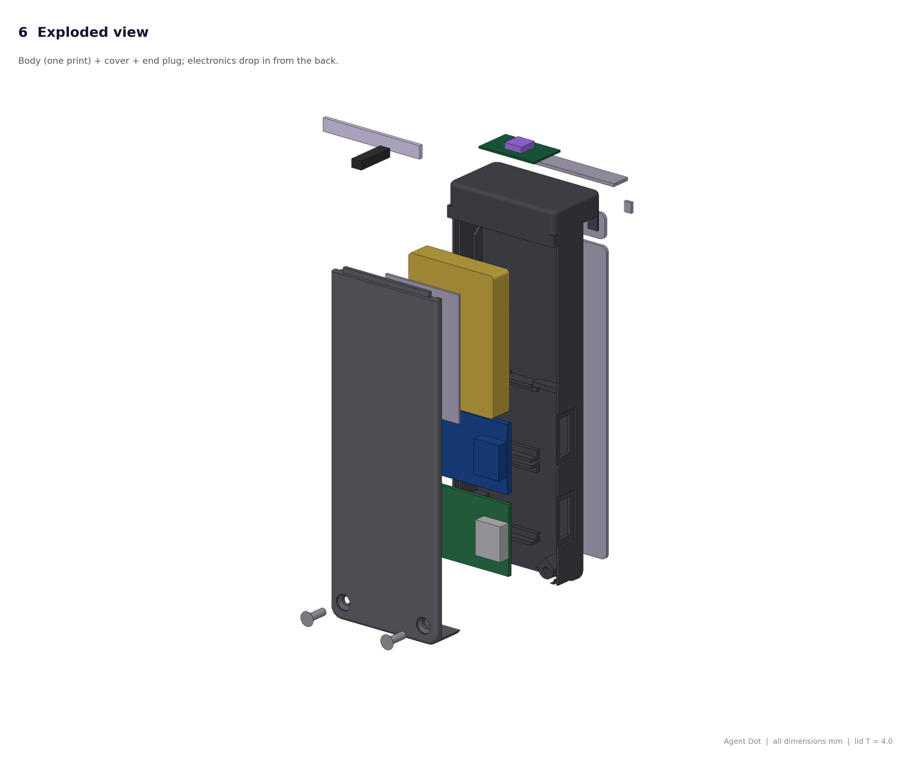

# Build guide: Agent Dot v12

This guide takes you from a parts list to a working light on your laptop.



| Step | What | Time |
|---|---|---|
| 1 | [Get the parts](#1-get-the-parts) | – |
| 2 | [Check your laptop](#2-check-your-laptop) | 2 min |
| 3 | [Print](#3-print) | ~2 h |
| 4 | [Prepare the electronics](#4-prepare-the-electronics) | 20 min |
| 5 | [Flash and test on the bench](#5-flash-and-test-on-the-bench) | 15 min |
| 6 | [Assemble](#6-assemble) | 30 min |
| 7 | [Connect Claude](#7-connect-claude) | 5 min |

---

## 1. Get the parts

The full list is in [BOM.md](BOM.md). You need:

- **ESP32-S3 or ESP32-C3 SuperMini**
- **TP4056 USB-C** charger board with protection, **no longer than 28 mm**
- **1S LiPo**, at most 6.0 × 25.5 × 36 mm (502535, 403035, 602535, 402530 …)
- **MSK-12C02 micro slide switch** (6.7 × 2.6 mm)
- **1 pixel** cut from a 10 mm wide WS2812B strip (no more than 2.1 mm tall)
- 330 Ω resistor and thin silicone wire (28–30 AWG)
- 2 × **M2×6 countersunk** screws
- A 1 mm diffuser strip, 29 × 3.4 mm (opal acrylic, frosted PET or white PETG)
- Filament: **white or light PETG** and **TPU 95A**

## 2. Check your laptop

The print files are made for a **4.0 mm lid** (MacBook Pro M4 Pro).

1. Measure your lid **at its top edge** with calipers.
2. If it is not 4.0 mm, set `LAPTOP_T` and rebuild the files ([CAD.md](CAD.md#rebuilding-the-print-files)).
3. The light covers the middle 32 mm of the lid edge. Make sure the clamp's two fingers, ±16 mm from the centre, clear your webcam. On MacBooks they do.

## 3. Print

| File (`hardware/print/3mf/`) | Material | Notes |
|---|---|---|
| `6_AgentDot_v12_onepiece_PETG.3mf` | PETG, **white or light** | body, cover and 2 end plugs (one spare) |
| `6b_TPU_pads_v12.3mf` | TPU 95A | 2 sets of pads |

Settings and orientation: [PRINTING.md](PRINTING.md). After printing:

1. Clear any stringing from the two USB-C openings, the switch slot and the wire hole.
2. Test-fit a USB-C cable in both openings before you install anything.

## 4. Prepare the electronics

1. **TP4056 charge current**: replace R3 with **4 kΩ**, which gives about 300 mA ([BOM.md](BOM.md#tp4056-charge-current-important)). The stock 1 A is too much for a small cell.
2. **Cut one pixel** from the strip, cutting across the copper pads on both sides of it.
3. **Solder 3 wires to the pixel**, each ~12 cm long: 5V, GND and DIN (data in, on the side the arrow points away from).
4. **Plan the wiring** ([WIRING.md](WIRING.md)):

   ```
   LiPo +/-     -> TP4056 B+/B-
   TP4056 OUT+  -> switch -> SuperMini 5V  + pixel 5V
   TP4056 OUT-  ----------> SuperMini GND  + pixel GND
   SuperMini GPIO10 -> 330 ohm -> pixel DIN
   ```

## 5. Flash and test on the bench

Do this **before** assembly. It is much easier to fix problems with everything still out on the table.

1. Follow [FIRMWARE.md](FIRMWARE.md):
   1. Choose **ESP32S3 Dev Module** or **ESP32C3 Dev Module** (whatever the chip on your SuperMini says), with **USB CDC On Boot: Enabled**.
   2. Install the Adafruit NeoPixel and WiFiManager libraries.
   3. Optional: set **`NUM_LEDS 1`**. Leaving it at 3 also works.
2. Plug the SuperMini into USB, then:
   1. Join the **AgentDot-Setup** Wi-Fi.
   2. Choose your 2.4 GHz network.
   3. The pixel turns **dim teal** once connected.
3. Note the IP printed in the Serial Monitor.
4. Test it: `curl "http://<ip>/s?c=working"` should turn the pixel purple.
5. Unplug USB. Wire in the TP4056, battery and switch, then switch on: it should boot from the battery.

## 6. Assemble

Follow the assembly steps in [hardware/README.md](../hardware/README.md#assembly). Left and right are as seen **from the front** of the laptop. Pictures: [`03_internal.png`](../hardware/drawings/views/03_internal.png) and [`04_section.png`](../hardware/drawings/views/04_section.png).

Then fit it:

1. Slide it onto the lid edge from above.
2. It should be snug and should not rock.
3. If it's loose, add a layer of tape under the rear pad. If it's tight, sand the pads.

> **Take the light off before you close the lid.**

Charge through the **upper** USB-C (TP4056). The lower one (SuperMini) is for flashing firmware. Flash with the switch **OFF**.

## 7. Connect Claude

- **Claude Code**: `bash hooks/install.sh <light-ip>`. See [CLAUDE_CODE.md](CLAUDE_CODE.md).
- **Claude desktop app (Mac)**: `bash mac/install.sh <light-ip>`, then allow Accessibility. See [CLAUDE_APP.md](CLAUDE_APP.md).
- **Anything else**: one HTTP request. See [API.md](API.md).

The full software walkthrough, with expected output for every step, is in [INSTALL.md](INSTALL.md).

Then send a prompt. The light goes **purple** while Claude works, **amber** when it needs you, and **green** when it is done.

Problems? See [TROUBLESHOOTING.md](TROUBLESHOOTING.md).
