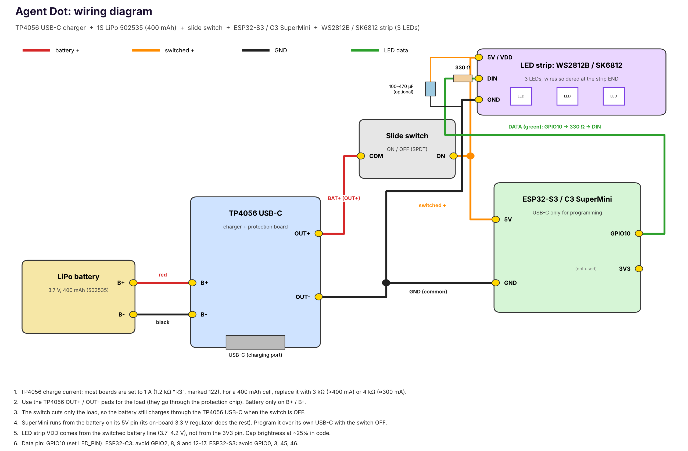

# Wiring

([PDF](images/wiring_diagram.pdf) · regenerate with `python3 docs/wiring_diagram.py`)

## Connections

| From | To |
|---|---|
| Battery + | TP4056 **B+** |
| Battery − | TP4056 **B−** |
| TP4056 **OUT+** | switch **COM** |
| switch **ON** | SuperMini **5V** pin **and** pixel **5V** |
| TP4056 **OUT−** | SuperMini **GND** **and** pixel **GND** |
| SuperMini **GPIO10** | **330 Ω** → pixel **DIN** |

## In the v12 case

- The pixel's 5V, GND and DIN wires go down the **wire hole** beside the pixel's right end, straight into the controller box.
- Inside the box, run the wires through the **open band above the battery** and down the sides. Keep them off the USB-C openings.
- Charge through the **upper** USB-C (TP4056). Flash through the **lower** one (SuperMini). Both are in the left wall (seen from the front of the laptop).
- Optional: set `NUM_LEDS 1` in the firmware (3 also works).

## Rules

- Load goes on **OUT+ / OUT−** (through the protection chip). The battery only goes on B+ / B−.
- The switch cuts only the load, so the battery still charges through the TP4056's USB-C when the switch is OFF.
- The SuperMini runs from the battery on its **5V** pin; its own regulator makes 3.3 V.
- Power the pixel from the switched battery line, **not** the 3V3 pin. The firmware caps brightness (`MAX_BRIGHTNESS`).
- Solder the pixel's wires on its **input** side (the arrow on the strip points away from it).
- **Flash the firmware with the switch OFF**, so the battery and USB never feed the board together.

## Choosing the data pin

`LED_PIN` in the firmware must match the pin you wire (default 10).

| Board | Good pins | Avoid |
|---|---|---|
| ESP32-S3 SuperMini | 1–13 (10 is the default) | 0, 3, 45, 46 (boot/strapping), 48 (on-board RGB) |
| ESP32-C3 SuperMini | 0, 1, 3, 4, 5, 6, 7, 10 | 2, 8, 9 (boot/strapping, on-board LED, BOOT button); 12–17 (flash) |

If the chip on your board says ESP32-**S3**, choose **ESP32S3 Dev Module** in the Arduino IDE; for **C3**, **ESP32C3 Dev Module** ([FIRMWARE.md](FIRMWARE.md)).

## Power and battery life

Wi-Fi uses most of the power. The firmware runs the CPU at 80 MHz, keeps the radio in modem sleep, and lets the idle glow go dark after 10 quiet minutes ([FIRMWARE.md](FIRMWARE.md#power-and-battery)). Expect roughly 8–12 hours from a 400 mAh cell on a C3 (estimate, not yet measured), less on an S3. Charge through the TP4056's USB-C.
