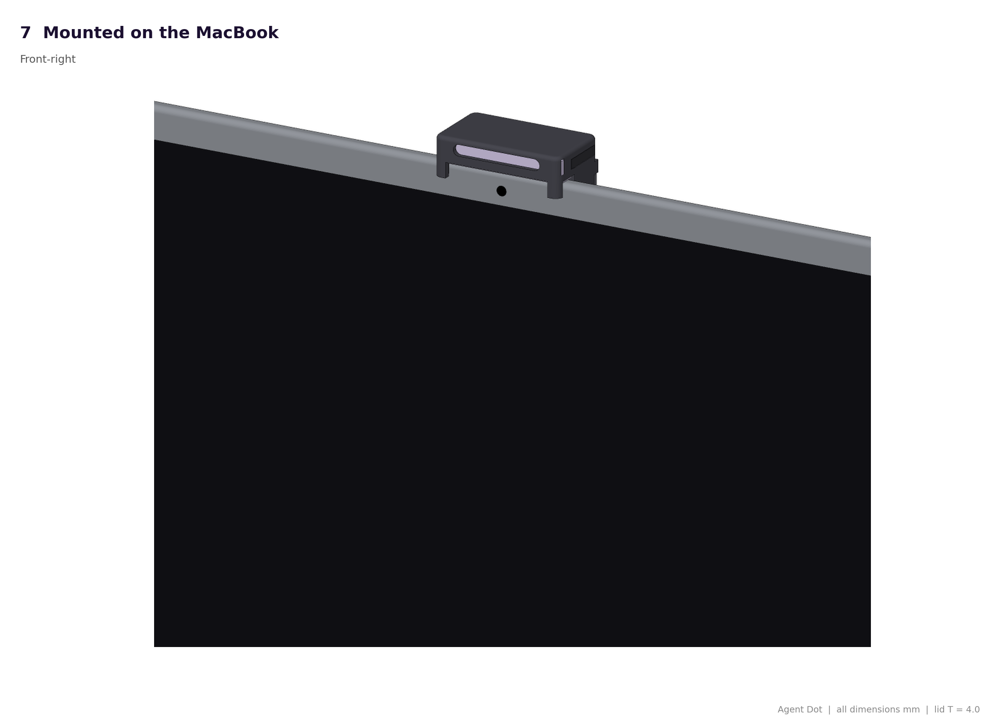
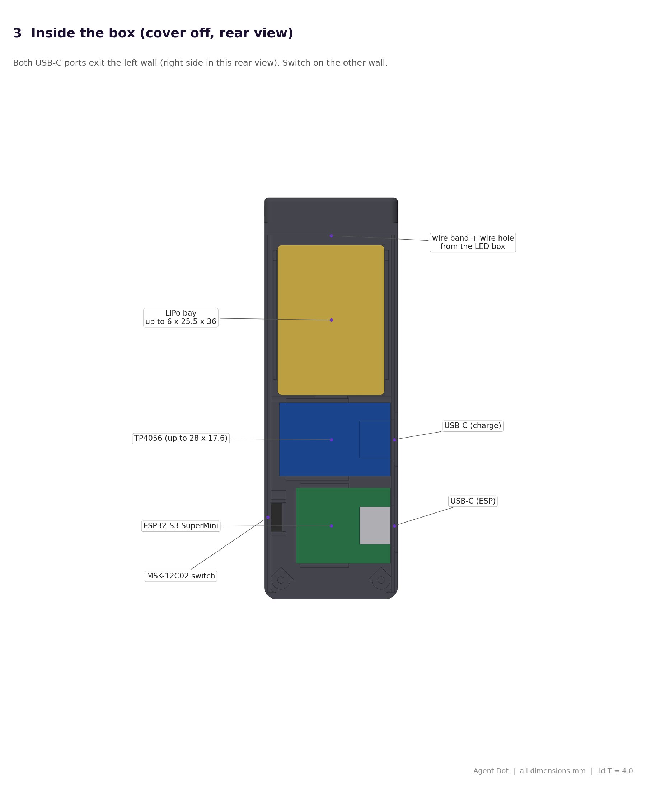
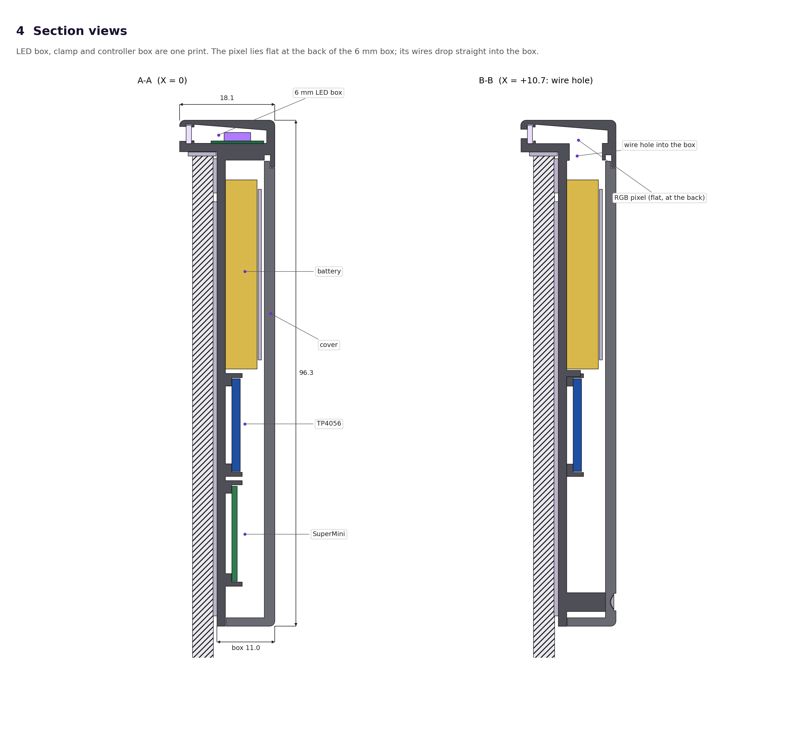
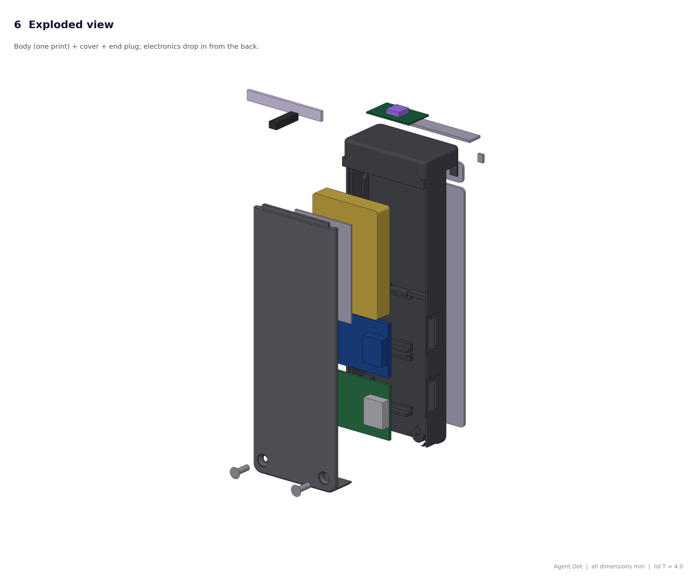

# Hardware: Agent Dot v12 (one-piece body)



| Inside (cover off) | Section | Exploded |
|---|---|---|
|  |  |  |

There are only two main prints:

- **Body**: the 6 mm LED box, the lid clamp and the controller box, printed as one piece.
- **Cover**: the back cover. It hooks under a ledge at the top and is held by 2 × M2×6 countersunk screws.

A tiny **end plug** closes the LED slot, and thin **TPU pads** line the clamp.

| | |
|---|---|
| Overall | 32 W × 96.3 H × 18.1 D mm |
| Above the lid edge | 6.8 mm |
| Behind the lid | 11.0 mm |
| Box inside | 28.8 × 86 × 7.4 mm |
| Lid | 4.0 mm (MacBook Pro M4 Pro) |

## How it's laid out

- **LED.** One RGB pixel lies flat at the **back of the LED box**, 3.4 mm behind a front diffuser. A large wire hole beside it leads straight down into the controller box.
- **Controller box**, from top to bottom:
  - a band for wires
  - a battery bay for cells up to 6.0 × 25.5 × 36 mm
  - a slot for a **TP4056 USB-C** charger up to 28 × 17.6 mm
  - a slot for an **ESP32 SuperMini** (S3 or C3)
- **USB-C.** Both ports open in the **left wall** (seen from the front of the laptop): the upper one charges (TP4056), the lower one is for flashing the ESP. Each has a recess, so cables with thick shells still seat.
- **Switch.** An MSK-12C02 micro slide switch sits in a pocket in the right wall, with a finger recess.

## Files

| Folder | What |
|---|---|
| `print/3mf/6_AgentDot_v12_onepiece_PETG.3mf` | Bambu A1 plate: body, cover and 2 end plugs (one spare). PETG, **white or a light colour**: the inside of the LED box is the reflector. |
| `print/3mf/6b_TPU_pads_v12.3mf` | Bambu A1 plate: lid pads and battery pad, 2 sets. TPU 95A. |
| `print/stl/` | The same parts as STL, already in print orientation |
| `step/` | Body, cover, end plug and the full assembly (with the electronics), for editing |
| `drawings/AgentDot_Drawings_v12_onepiece.pdf` | Dimensioned drawings (front, rear, internal, sections, exploded, mounted) |
| `drawings/views/` | The same views as PNGs |
| `validation/validation_report_v12_onepiece.txt` | Fit, interference and printability checks: all pass |
| `cad/` | The parametric FreeCAD model and the scripts that make all of the above |

## Print

- **No supports needed.** The parts are already in print orientation:
  - The body stands on the top of its LED box, with the controller box pointing up.
  - The cover lies on its back.
- Settings: 0.2 mm layers, 3 walls, 15 % infill.
- Use a **5 mm brim** on the body and on the end plugs. They are tall and narrow.
- Bambu Studio says *"load geometry data only"* when it opens the 3MF. That is normal.

Full step-by-step build: [docs/BUILD_GUIDE.md](../docs/BUILD_GUIDE.md).

## Electronics

| Part | Size limit | Where |
|---|---|---|
| 1S LiPo | up to **6.0 × 25.5 × 36 mm** (e.g. 502535, 403035, 602535 or a 300 mAh 402530). For thinner cells, add a piece of foam. | top bay |
| TP4056 USB-C charger | up to **28 × 17.6 mm** | middle slot, USB-C at the **left wall** |
| ESP32-S3 or ESP32-C3 SuperMini | 22.6 × 18.1 mm | bottom slot, USB-C at the **left wall** |
| MSK-12C02 slide switch | 6.7 × 2.6 × 1.4 mm | pocket in the right wall, lever in a finger recess |
| 1 RGB pixel cut from a 10 mm strip | 16.9 mm long, ≤ 2.1 mm tall | flat at the back of the LED box |
| 2 × M2×6 countersunk screws | | hold the cover |

**Measure your TP4056 first.** Most USB-C versions are 26–28 × 17 mm. If yours is longer than 28 mm, it won't fit.

## Assembly

1. **LED pixel**
   1. Cut one LED from the strip, with the solder pads on its right-hand end.
   2. Solder the 3 wires: 5V, GND and DIN.
   3. Slide the pixel in through the slot in the right-hand end of the LED box, LED facing up, until it reaches the stop.
   4. Feed the wires down the **wire hole**. It sits next to the pixel's right end and leads straight into the box.
2. **Diffuser**: cut a strip of white PETG or diffuser film, about 29 × 3.4 × 1 mm. Slide it in the same way, into the front groove.
3. **End plug**: press it into the slot. A drop of glue keeps it in.
4. **Boards**
   1. Lay the TP4056 into the middle slot and the SuperMini into the bottom slot, components facing the cover.
   2. Push each board against the left wall until its USB-C port sits in its opening.
   3. The small catches hold the boards' edges.
5. **Switch**: drop the MSK-12C02 into the pocket on the right wall, lever pointing out. The cover holds it in.
6. **Wiring** (details in [docs/WIRING.md](../docs/WIRING.md)):

   | From | To |
   |---|---|
   | Battery | TP4056 B+ / B− |
   | TP4056 OUT+ | switch |
   | Switch | SuperMini 5V |
   | TP4056 OUT− | GND |
   | Pixel DIN | 330 Ω → GPIO10 |
   | Pixel 5V / GND | SuperMini 5V / GND |

   The open band above the battery carries the wires across.
7. **Battery**: put the cell in the top bay with the thin TPU pad on top.
8. **Cover**
   1. Hold the cover 1.6 mm low, then slide it up so that its top tab hooks under the ledge.
   2. Fit the 2 × M2×6 screws at the bottom. Never longer: longer screws reach the laptop.
9. **TPU pads**: stick them onto the clamp. Then clip the light onto the lid.

> Take the light off before you close the laptop.

## Firmware

No change is needed. With `NUM_LEDS 3` the two missing pixels are simply ignored; set `NUM_LEDS 1` in `firmware/AgentDot/AgentDot.ino` for a tidier setup.

## Rebuilding the CAD

Everything comes from one parametric FreeCAD macro, `cad/agent_dot.FCMacro`, with the v12 settings in `cad/v12.py`. See [docs/CAD.md](../docs/CAD.md) for the structure and every parameter. The short version:

```bash
cd hardware/cad
freecadcmd -c "exec(open('validate_v12.py').read())"   # 1. checks -> must say ALL CHECKS PASSED
freecadcmd -c "exec(open('export_v12.py').read())"     # 2. STL + STEP
python3 make_3mf_v12.py                               # 3. Bambu plates (plain Python)
freecadcmd -c "exec(open('render_v12.py').read())"     # 4. drawings
```

Output goes to `hardware/cad/out/` (git-ignored). Copy the results into `print/`, `step/`, `drawings/` and `validation/` to publish them.

**Different laptop?** Measure the lid at its top edge and add `LAPTOP_T=<mm>` to `VOVR` in `cad/v12.py`, then run the four steps.

## Checks

`validation/validation_report_v12_onepiece.txt` (all pass):

- no part interference, electronics included
- both boards drop in from the back, and a real USB-C plug reaches both ports
- the switch lever has its full travel and is reachable from outside
- the pixel, diffuser and wires go in freely
- the cover slides on, hooks at the top and can't slide sideways
- the clamp gap matches the lid, and the webcam area stays clear
- every part prints with no supports
